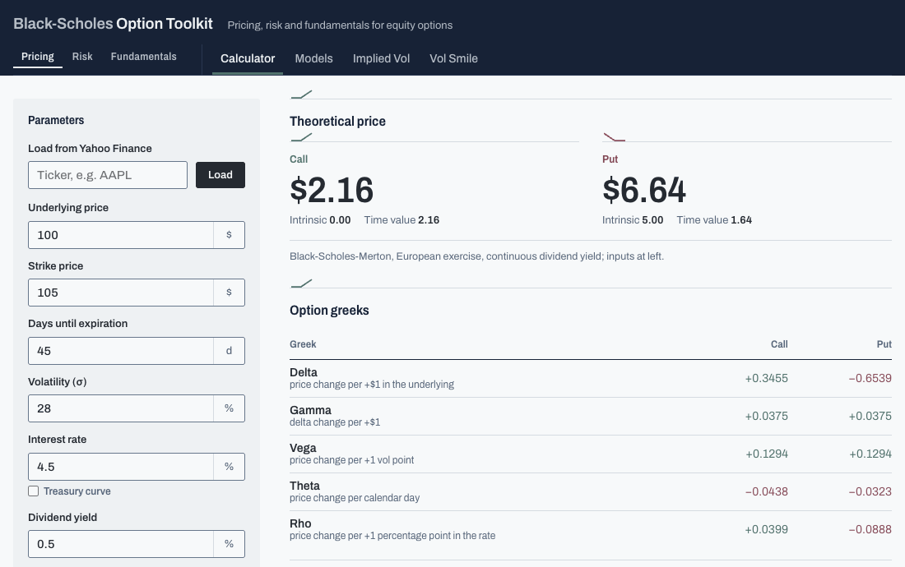
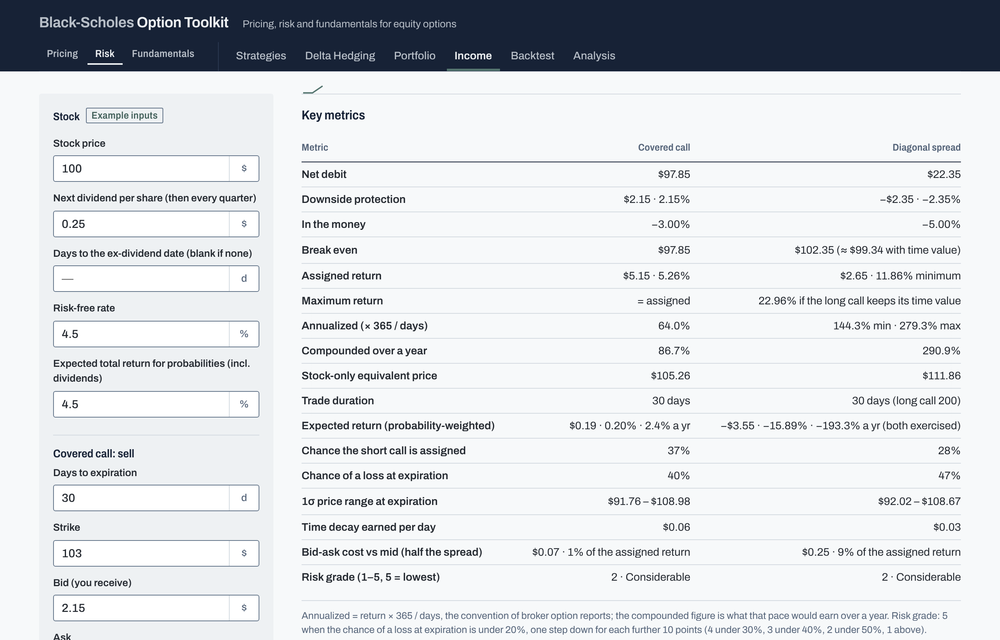
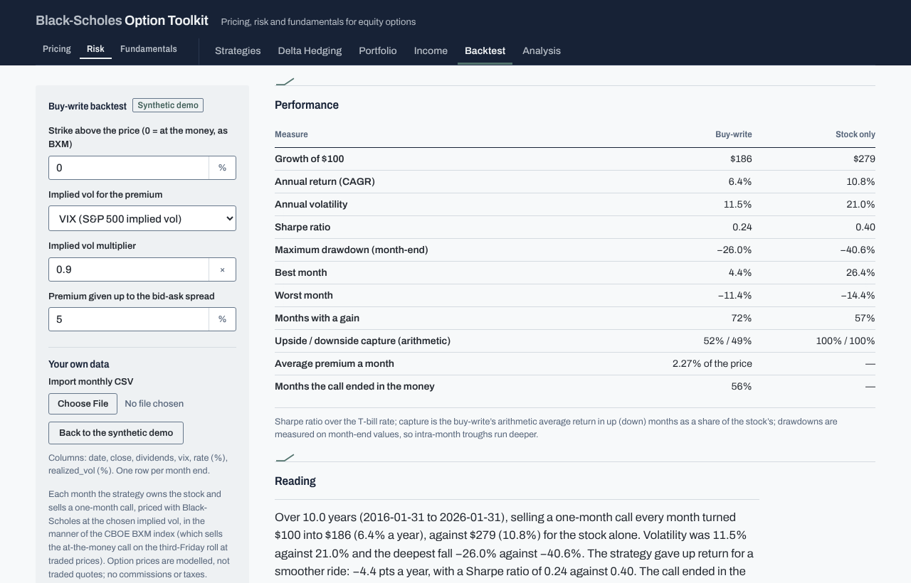
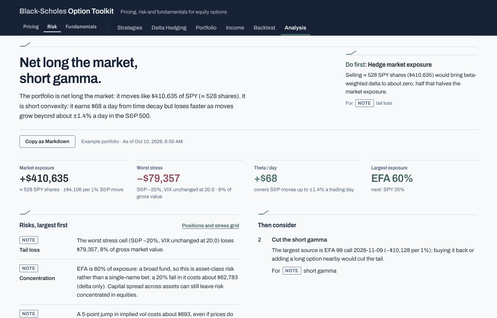
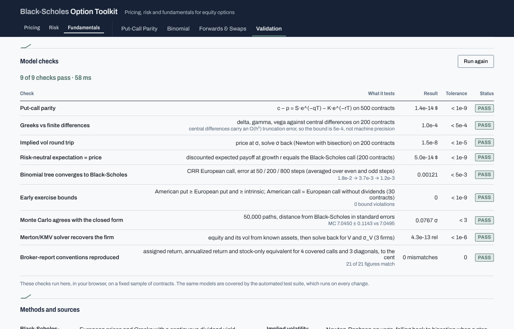
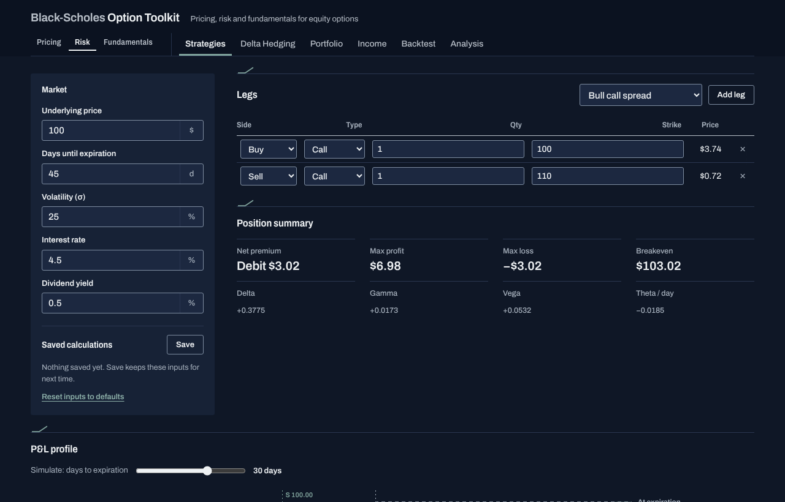
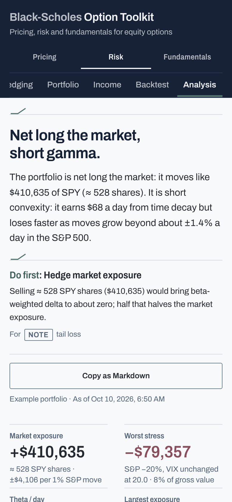
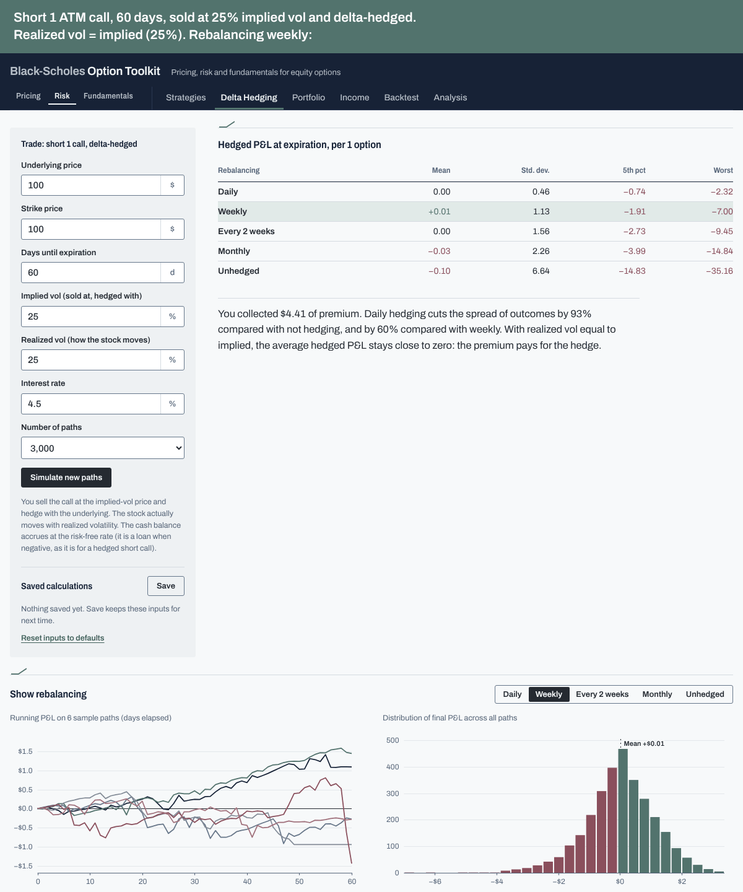
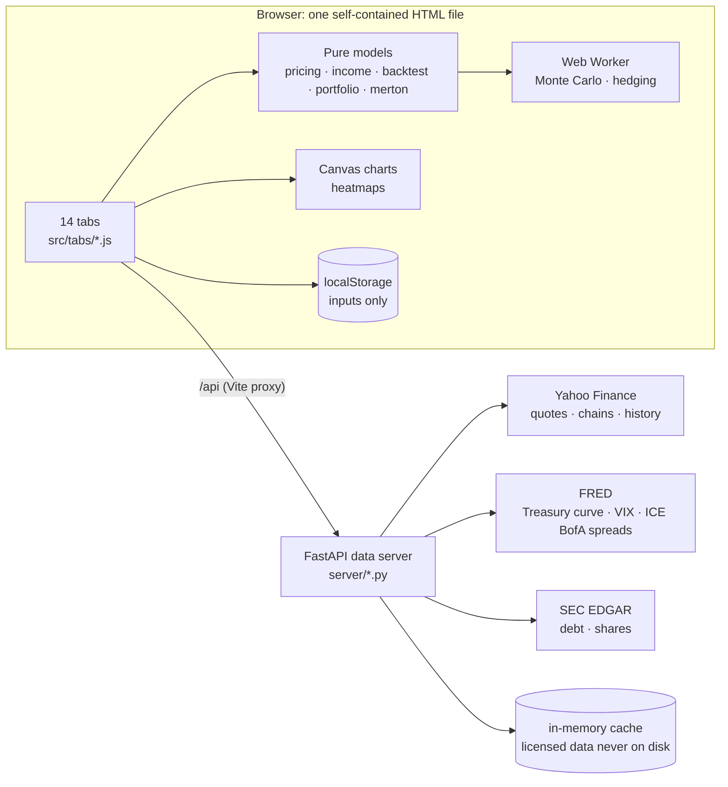

# Option Toolkit

**An equity-options workbench that prices, stress-tests and explains option positions, and checks its own maths
while you watch.** Black-Scholes, binomial trees and Monte Carlo; multi-leg strategies and portfolio risk;
covered calls and diagonals in the conventions of broker option reports; a buy-write backtest; Merton/KMV firm
value against market credit spreads; and a plain-English risk memo built from the numbers.

This repository is a showcase: it holds the description, recordings and screenshots of the app. **The source code
is private** and available on request (see [Source code](#source-code) below). The app builds into one HTML file
that runs on example inputs and a synthetic market, and loads live data from Yahoo Finance, FRED and SEC EDGAR
through a small local data server.

## What this project shows

- **Derivatives pricing.** Black-Scholes-Merton with Greeks, implied vol (Newton with a bisection fallback), CRR
  trees with American exercise, Monte Carlo with confidence intervals, delta-hedging simulations, the volatility
  smile and surface from live chains, put-call parity and arbitrage, forwards and swaps off a bootstrapped
  Treasury zero curve. The textbook basis is Hull and the CFA Program derivatives curriculum.
- **Applied portfolio risk.** Dollar Greeks, beta-weighted delta in SPY terms, and full revaluation over a VIX ×
  S&P 500 grid. The **Analysis** tab turns these into a ranked risk memo with the one action to take first. The
  memo comes from fixed rules, not an AI model, so the same inputs always give the same memo.
- **Industry conventions, reproduced exactly.** The **Income** tab computes covered-call and diagonal metrics the
  way broker option reports do, and matches 21 of 21 published figures to the cent. It then adds what those
  reports leave out: probabilities, the expected return, price ranges where each trade beats the stock, early
  assignment risk around dividends, and a scanner.
- **Honest backtesting.** A BXM-style monthly buy-write against holding the stock: CAGR, Sharpe ratio, drawdown,
  capture ratios and calendar years. The tab says which inputs are modelled and warns when VIX misprices a single
  stock.
- **Credit as an option.** Merton/KMV backs out asset value and volatility from a company's SEC filings and
  equity data. The model credit spread sits next to ICE BofA market spreads and agency ratings.
- **Verification.** A **Validation** tab runs nine checks in the browser (parity, Greeks, implied-vol round trips,
  tree convergence, early-exercise bounds, Monte Carlo against the closed form, Merton round trips, the published
  report figures). Behind them sit 701 Vitest tests and 77 pytest tests, and CI runs them on every push.
- **Product and engineering.** Vanilla JavaScript ES modules built into one self-contained HTML file. The charts
  are hand-written Canvas, and simulations run in a Web Worker. A FastAPI data server keeps licensed data out of
  storage. Inputs and saved calculations persist across visits, any report exports to PDF, there is a dark theme,
  and the app works with the keyboard and on a phone.

| Income: broker-report metrics with probabilities | Backtest: buy-write against the stock |
| --- | --- |
|  |  |
| **Analysis: a risk memo from the numbers** | **Validation: the models checked live** |
|  |  |
| **Strategies, dark theme** | **On a phone** |
|  |  |

## Case study: does selling options pay once it is hedged?

An option seller who delta-hedges is no longer betting on direction; what is left is a bet on volatility. The
**Delta Hedging** tab tests that directly. It sells one 60-day at-the-money call at 25% implied vol (premium
$4.41), hedges it with the stock at five rebalancing frequencies, and lets the stock follow 3,000 simulated paths
at a realized vol that can differ from the implied one. Cash accrues at the risk-free rate.

| Realized vol | Rebalancing | Mean P&L | Std. dev. |
| --- | --- | --- | --- |
| 25% (= implied) | Daily | +0.00 | 0.46 |
| 25% | Weekly | +0.01 | 1.13 |
| 25% | Every two weeks | −0.00 | 1.56 |
| 25% | Monthly | −0.03 | 2.26 |
| 25% | Not hedged | −0.10 | 6.64 |
| 20% (below implied) | Daily | +0.81 | 0.46 |
| 30% (above implied) | Daily | −0.80 | 0.63 |

What it shows, and why:

- **The volatility gap sets the expected P&L.** A delta-hedged short option earns its theta and pays its gamma:
  P&L ≈ ½ · Γ · S² · (σ²_implied − σ²_realized) summed over the life of the trade, which to first order is
  vega × (σ_implied − σ_realized). Here vega × 5 points ≈ $0.80, against +0.81 and −0.80 in the simulation.
  When realized equals implied, the premium just pays for the hedge and the mean stays near zero.
- **Rebalancing frequency sets the dispersion, not the mean.** Hedging error shrinks roughly with the square root
  of the number of rebalances (Hull, *Options, Futures, and Other Derivatives*, ch. 19): daily hedging cuts the
  standard deviation by about 80% against monthly and 93% against not hedging, while the average barely moves.
- **Unhedged, the premium is a directional bet:** a similar mean, about 14 times the spread of daily hedging and a fat left tail.

Limits: geometric Brownian motion with constant volatility, no jumps or volatility clustering, no transaction costs
or bid-ask on the hedges. In practice those costs are what stop a desk from rebalancing ever more often, and jumps
are where short-volatility positions lose most. The simulation is seeded, so the GIF can be rebuilt with the same
figures.

## How it was built

This is a vibe-coded app. An AI coding assistant (Claude Code, by Anthropic) wrote the code from my prompts; I
did not write it line by line. My part was everything around the code: what to build, how the finance should
work, what the data may and may not do, and whether each result was right.

**What I did**

- **Scope and product decisions.** I chose the tabs and what each should answer, from single-option pricing to
  portfolio risk, income strategies, the backtest and firm value, and decided what to remove when it did not earn
  its place.
- **Financial conventions.** I brought real broker option reports and asked for their covered-call and diagonal
  metrics to be reproduced exactly (sold at the bid, bought at the ask, annualized × 365 / days), then for what
  they leave out: probabilities, expected returns, early-assignment risk. Textbook methods follow Hull and the CFA
  Program derivatives curriculum.
- **Data and licensing rules.** I set the limits: licensed ICE BofA spread data stays in memory and never in the
  repository or the static build; API keys and my contact details stay in a git-ignored `.env`; broker ratings,
  target prices and branding are never reproduced; market data is never stored in the browser.
- **Design direction.** I chose the palette and the look (a quiet, print-like analytical tool built from simple
  lines), chose among proposed design directions, and asked for changes where it looked too much like an
  existing publication.
- **Review.** I used the app as it grew, asked for design critiques and accessibility and performance audits,
  and had every finding fixed one by one.

**What the AI did**

- Wrote the JavaScript, CSS, HTML and Python, the tests, and this documentation, in many small iterations.
- Proposed the architecture: pure model functions shared by the tabs, the Web Worker, the Validation checks and
  the tests; a single-file build; a small FastAPI data server.
- Explained the trade-offs when asked (for example, why the backtest prices options with Black-Scholes at VIX,
  and where that misleads).

**How the numbers are checked**

Because I did not write the code myself, nothing is taken on trust:

- 701 Vitest tests and 77 pytest tests cover the pricing maths, the strategies, the portfolio, the income
  metrics, the backtest, the data server and the user interface. CI runs them on every push.
- The **Validation** tab runs nine checks live in the browser against theory and against each other: put-call
  parity, Greeks against finite differences, implied-vol round trips, tree convergence, early-exercise bounds,
  Monte Carlo against the closed form, the Merton solver, and the published report figures.
- The income metrics match 21 of 21 figures from published broker reports to the cent.

## Architecture

The models are pure functions with no DOM, so the same code runs in the tabs, the worker, the Validation checks
and the tests. Without the data server, every tab still works on example inputs, model option chains and a
synthetic market. The single-file build opened from disk runs in that mode.

## Tabs

| Section | Tabs |
| --- | --- |
| Pricing | Calculator · Models (Black-Scholes vs binomial vs Monte Carlo) · Implied Vol · Vol Smile |
| Risk | Strategies · Delta Hedging · Portfolio · Income · Backtest · Analysis |
| Fundamentals | Put-Call Parity (with Merton/KMV firm value) · Binomial · Forwards & Swaps · Validation |

Every tab has a deep link, such as `#income`, `#backtest` or `#validation`.

## Data and licensing

- **ICE BofA credit spreads** (through FRED) are licensed data. The app shows them only while it runs: the server
  keeps them in an in-memory cache and serves them with `Cache-Control: no-store`. Fetched spread data must never be
  written to files in this repository, added to tests or fixtures, or bundled into the static site.
- Yahoo Finance data is unofficial and for personal use. SEC EDGAR requests carry a `SEC_USER_AGENT` you set.
- Broker research ratings, target prices and proprietary rankings are neither used nor reproduced. The Income
  tab's risk grade uses a rule stated in the tab.
- Keys and contact details stay in a git-ignored `.env` file and are never committed.

This is an educational analysis tool, not investment advice.

## Source code

The code, the 701 Vitest and 77 pytest tests, the CI workflow and the full reference (every formula, data source and
endpoint) are in a private repository. Access for recruiters and reviewers is available on request.

## License

© 2026 Zuzanna Czernicka. All rights reserved: see [LICENSE](LICENSE). The code is AI-written under my direction, as
described in [How it was built](#how-it-was-built).
